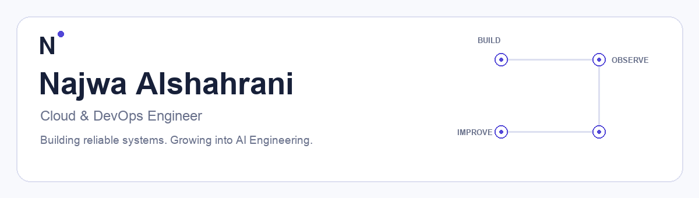
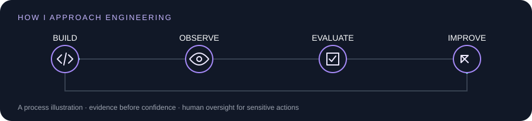
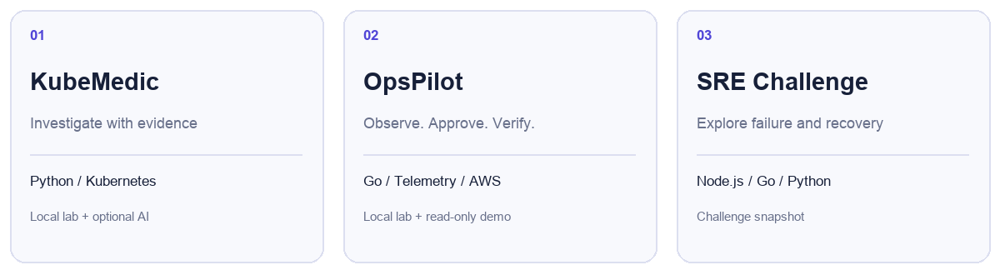

<a href="https://najwa-alshahrani-portfolio.e-newint1.chatgpt.site/">Portfolio</a> &nbsp; · &nbsp;
<a href="https://www.linkedin.com/in/najwaalshahrani">LinkedIn</a> &nbsp; · &nbsp;
<a href="najwa-header.png">View static header</a>

## Engineering with intent

I build projects around cloud infrastructure, Kubernetes, observability, and controlled incident recovery. I am expanding toward **AI Engineering**, bringing a systems perspective to deploying, evaluating, and operating reliable AI applications.

## Selected projects

### 01 · [KubeMedic](https://github.com/NajwaN96/kubemedic)

A **Python / Kubernetes reliability lab** that collects operational evidence, tracks incident recovery, and proposes human-approved remediation. Optional AI explains the evidence; deterministic rules remain authoritative.

[Reproducible AI evaluation](https://github.com/NajwaN96/kubemedic/tree/main/kubemedic/evaluation) · [Results and limitations](https://github.com/NajwaN96/kubemedic/blob/main/kubemedic/evaluation/RESULTS.md) · [AI implementation](https://github.com/NajwaN96/kubemedic/blob/main/kubemedic/app/ai/openai_analyzer.py) · [Sanitization tests](https://github.com/NajwaN96/kubemedic/blob/main/kubemedic/tests/test_ai_sanitize.py) · [Lessons learned](https://github.com/NajwaN96/kubemedic/blob/main/docs/lessons-learned.md)

See the lab and its scope

Local lab, with an unprovisioned AWS reference design. The offline evaluation uses 16 synthetic cases. A provider-quota error prevented live model answers; no live model-quality result is claimed. AI cannot execute Kubernetes operations.

### 02 · [OpsPilot](https://github.com/NajwaN96/opspilot)

A **Go / Kubernetes reliability control plane** connecting telemetry, incident detection, constrained rollback proposals, human approval, and recovery verification.

[Architecture](https://github.com/NajwaN96/opspilot/blob/main/docs/architecture/overview.md) · [Five-minute walkthrough](https://github.com/NajwaN96/opspilot/blob/main/docs/RECRUITER-DEMO.md) · [Read-only AWS demo](https://jcqljkrf25oijz4cryqw7c76lq0wmzhi.lambda-url.us-east-1.on.aws/) · [GitHub Actions](https://github.com/NajwaN96/opspilot/actions)

See the console and its scope

The interactive workflow runs locally. The public AWS portfolio presents sanitized, read-only samples; EKS is plan-only. [AI recommendations remain separate from execution](https://github.com/NajwaN96/opspilot/blob/main/docs/adr/0016-ai-recommendation-vs-execution.md).

### 03 · [Thmanyah SRE Challenge](https://github.com/NajwaN96/thmanyah-sre-challenge)

A **Node.js / Go / Python infrastructure challenge** exploring service integration, Kubernetes manifests, monitoring, and failure scenarios.

[Architecture diagram](https://github.com/NajwaN96/thmanyah-sre-challenge/blob/main/architecture.png) · [Failure scenarios](https://github.com/NajwaN96/thmanyah-sre-challenge/blob/main/scenarios.md) · [Reproduction status](https://github.com/NajwaN96/thmanyah-sre-challenge/blob/main/Readme.md)

This is a challenge snapshot. The README documents layout gaps that must be reconciled before reproducing the full deployment.

## Growing into AI Engineering

My systems projects provide a foundation in **deployment, monitoring, auditability, and human oversight**. My next learning priorities are **model evaluation, LLM applications, retrieval-augmented generation, and MLOps**.

I value clear boundaries: distinguish working implementations from reference designs, and connect technical claims to inspectable evidence.

## Public work, automatically refreshed

[Refresh workflow](https://github.com/NajwaN96/NajwaN96/actions/workflows/profile-visuals.yml) · [Generator](scripts/render_activity.py). Refreshed weekly and on demand using public repository metadata only. Icons are custom illustrations; animations are decorative, not live system status.
